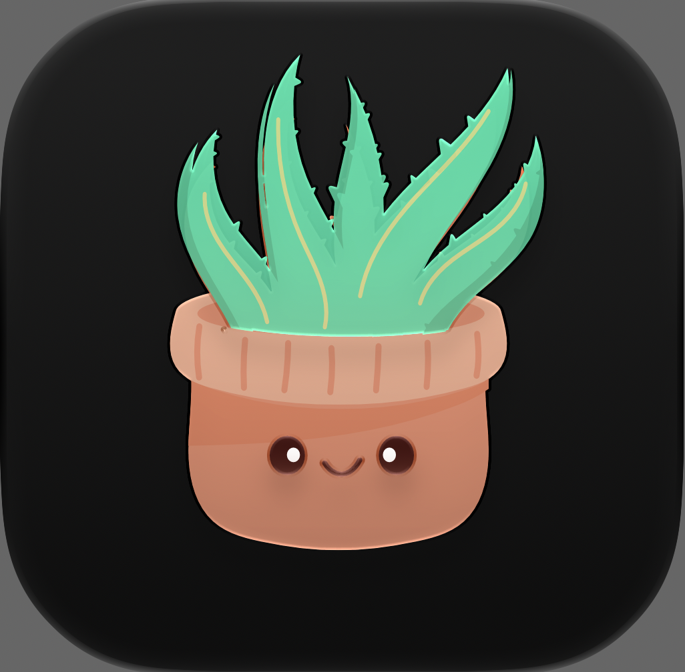
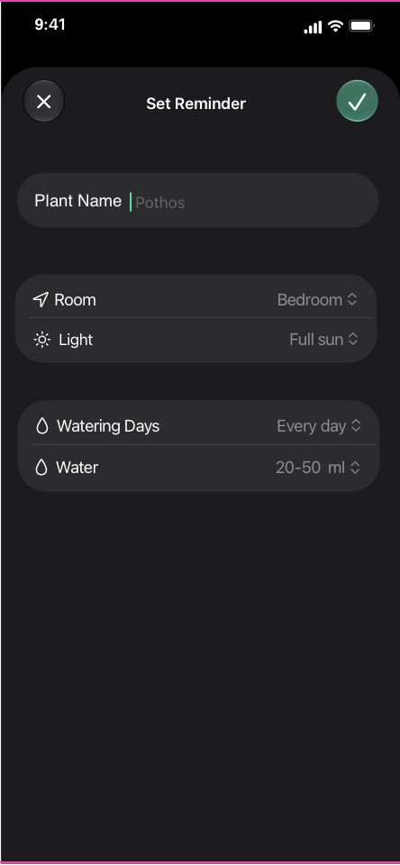
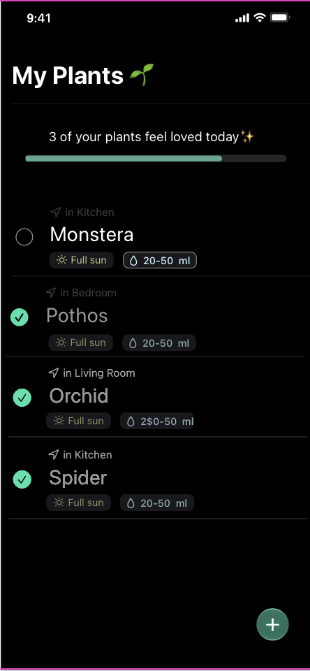
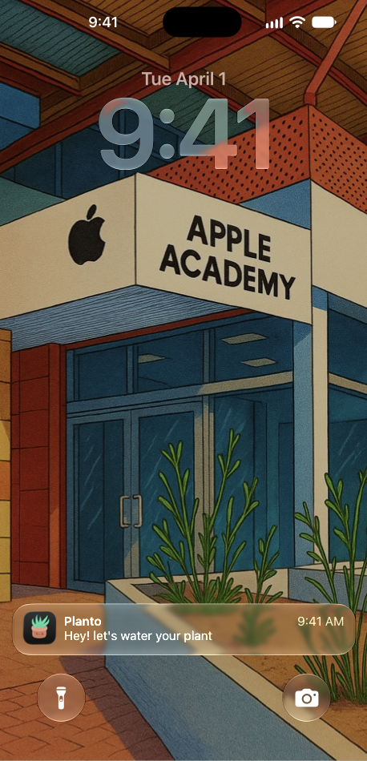

# 🌱 Planto

<p align="center">
  
</p>

<h1 align="center">Planto</h1>
<p align="center">
  <strong>Your plants, your care, your routine.</strong>
  <br>
  A simple way to organize your plants and never forget their care.
</p>

<p align="center">
  
  
  
</p>

---

## 📖 About

Planto is an iOS app designed to make plant care easier. It allows users to manage their plants, customize care details, create reminders, and keep track of completed tasks — all in one place.

## 📸 Screenshots

<p align="center">
  
  
  
  
  
</p>

## ✨ Features

| Feature | Description |
|---|---|
| 🌿 Add Plants | Add plants to your personal collection. |
| 🔔 Receive Notification | Receive a notification when it is time to water your plants. |
| ✏️ Edit Plant Information | Update plant information whenever needed. |
| 🗑️ Delete Plants | Remove plants from your collection, by swipe or from the edit form. |
| ✅ Mark as Done | Mark completed care reminders and track your progress. |
| 🔁 Plants Come Back | A checked plant reappears when its next watering day arrives. |
| 💾 Saved Locally | Plants are stored on the device and kept between launches. |
| 👋 Onboarding | A welcome screen shown only the first time the app opens. |

## 🏗️ Architecture

The project follows the **MVVM** design pattern.

```
Plantoo/
├── Models/           // Reminder (struct), PlantOptions (enums)
├── ViewModels/       // RemindersViewModel, NotificationManager
├── Views/            // ContentView, SetReminderView, onboarding and state screens
└── Extensions/       // Sample data
```

## 📚 Concepts Learned

- **Structs, classes and enums:** `Reminder` is a struct (plain data), `RemindersViewModel` is a class (shared state), and the option lists are enums.
- **Optionals:** `lastCompletedDate: Date?`, `reminder: Reminder?` to tell adding from editing, and `guard let`.
- **Codable and UserDefaults:** plants are encoded to JSON and saved locally.
- **Local notifications:** `UserNotifications` schedules a repeating alert based on the watering interval.
- **Liquid Glass:** used on the add, confirm, and onboarding buttons.
- **Git:** feature work committed in small, clear steps.

## 🛠️ Built With

- **Swift**: programming language
- **SwiftUI**: user interface framework
- **Xcode**: development environment

## ▶️ How to Run

1. Clone the repository.
2. Open `Plantoo.xcodeproj` in **Xcode 26** or later.
3. Choose an iPhone simulator running **iOS 26**.
4. Press **⌘R**.

## 📱 Platform

iOS

<p align="center">
  Made with 🌱
</p> 
