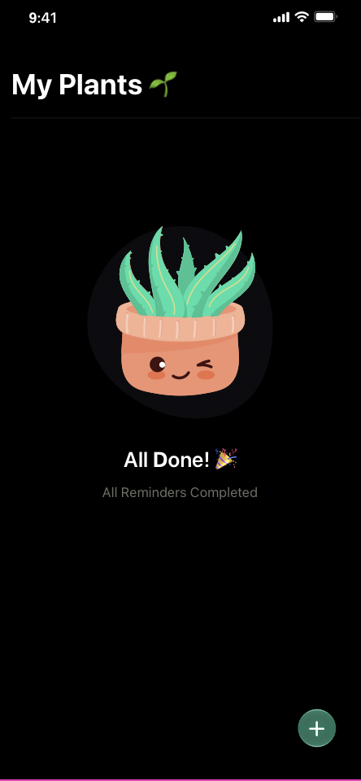

# 🌱 Planto

\
   \<strong>Your plants, your care, your routine.\</strong>   \    A simple way to organize your plants and never forget their care. \

\
   \   \   \ \

---

## 📖 About

Planto is an iOS app designed to make plant care easier. It allows users to manage their plants, customize care details, create reminders, and keep track of completed tasks — all in one place.

## 📸 Screenshots

\
   \   \   \   \ \ \

## ✨ Features

| Feature                   | Description                                         |
| ------------------------- | --------------------------------------------------- |
| 🌿 Add Plants             | Add plants to your personal collection.             |
| 🔔 Receive Notification   |  Receive notification when it is time to water your plants.|
| ✏️ Edit Plant Information | Update plant information whenever needed.           |
| 🗑️ Delete Plants         | Remove plants from your collection.                 |
| ✅ Mark as Done            | Mark completed care reminders and track your tasks. |

## 🛠️ Built With

- **Swift** — Programming language
- **SwiftUI** — User interface framework
- **Xcode** — Development environment

## 📱 Platform

iOS

---

\
   Made with 🌱 \

 
