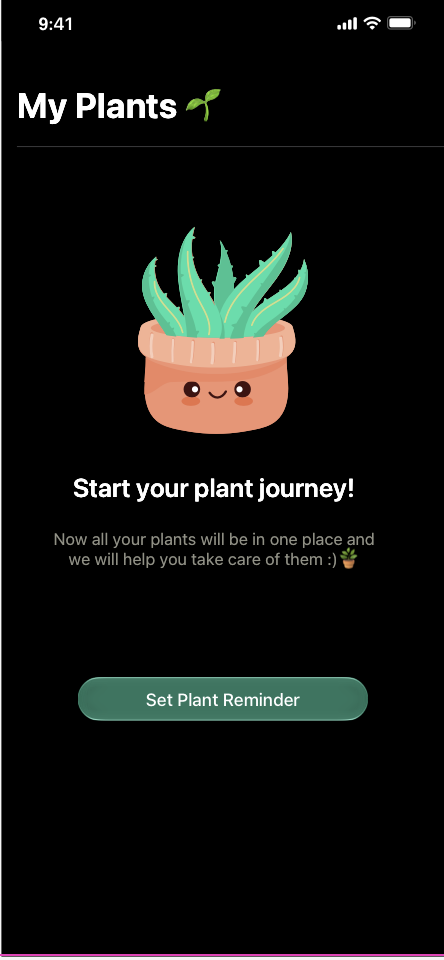

# Planto
Planto is an iOS application designed to help users take care of their plants by organizing plant information and managing personalized care reminders.

## Features
- Add Plants: Add plants to your personal collection. 

- Care Reminders: Create reminders with specific plant care details.

- Update Plant Information: Edit and update plant details whenever needed.

- Delete Plants: Remove plants from your collection.

- Mark as Done: Mark completed care reminders as done to keep track of your tasks.

## Built With

Swift

SwiftUI

Xcode

## Platform

iOS

 
